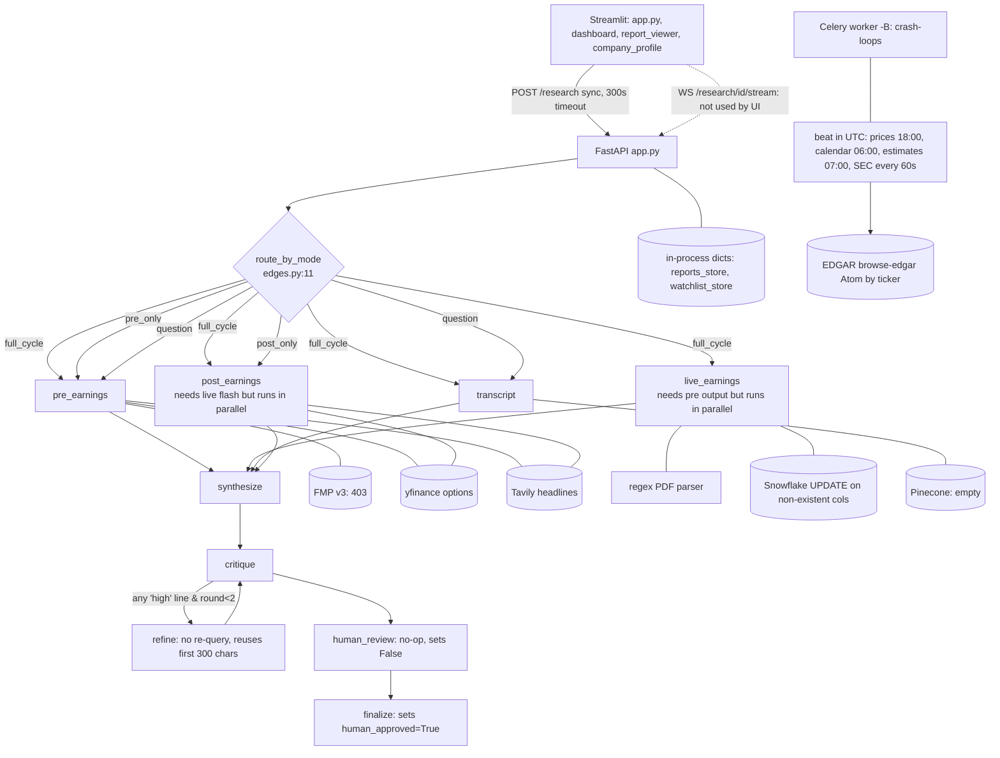
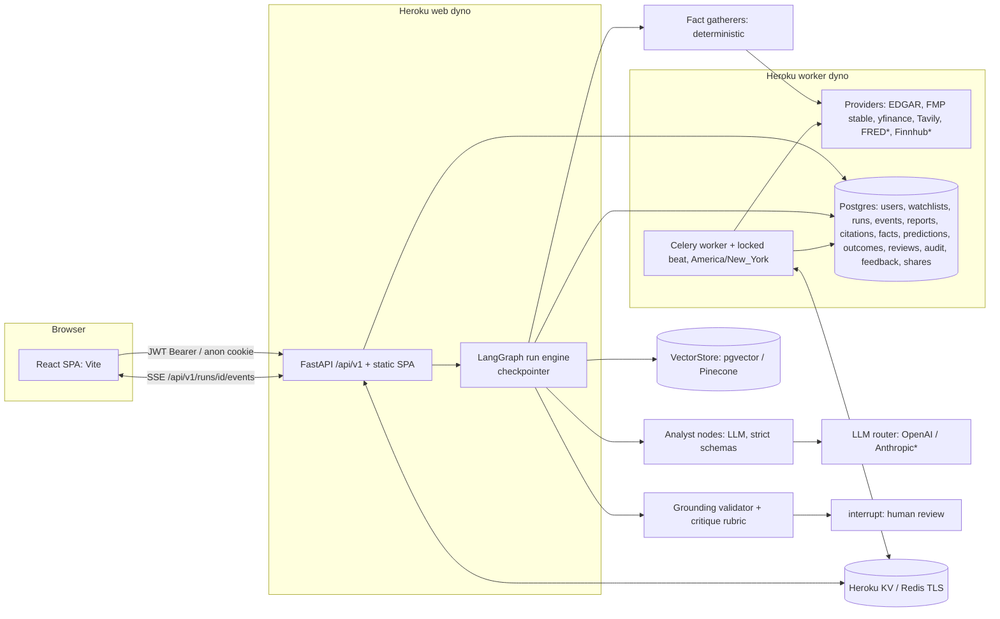

# Earnings Intelligence Platform — Upgrade Plan

Branch: `upgrade` (from `main_2026` @ 0073a14). Author: lead engineer (Claude), 2026-11-20.
Assumed user: a professional sell-side/buy-side analyst or PM covering US-listed equities. The repo
says nothing different, so this is recorded under *Decisions made*.

---

## 0. Inventory (names only, no values)

| Kind | What is available |
|---|---|
| Local `.env` | `OPENAI_API_KEY`, `OPENAI_MODEL` (=gpt-4o), `EMBEDDING_MODEL`, `SNOWFLAKE_{USER,PASSWORD,ACCOUNT,WAREHOUSE,DATABASE,SCHEMA}`, `PINECONE_API_KEY`, `PINECONE_{TRANSCRIPTS,FILINGS}_INDEX`, `TAVILY_API_KEY`, `FMP_API_KEY`, `REDIS_URL`, `SEC_RSS_POLL_INTERVAL`, `MAX_CRITIQUE_ROUNDS` |
| Heroku config (`earnings-intel-platform`) | **`REDIS_URL` only.** No LLM, data or store keys in production. |
| Heroku | heroku-24 stack, 1 Basic web dyno + 1 Basic worker dyno, `heroku-redis:mini`, no Postgres, no custom domain (ACM off) |
| Missing keys | `ANTHROPIC_API_KEY`, `FRED_API_KEY`, `FINNHUB_API_KEY`, Polygon, Alpha Vantage, Clerk/Auth0, Sentry, Langfuse, `DATABASE_URL` |
| CLIs | heroku 11.13, gh 2.86, docker 27.5, psql/pg_ctl 16, redis-server 7.2, node 25.6, npm 11.9, uv 0.10, python 3.12. No snowsql. |
| MCP / tools | Built-in browser pane (for UI verification), Claude-in-Chrome, web search/fetch, Apify (not used: scraping not needed), Figma (needs auth, not used) |
| OpenAI models visible to the key | gpt-4o, gpt-5.x, gpt-5.4-mini/nano, gpt-6-luna, gpt-6-sol, gpt-6.2-sol, gpt-6.2-astra, text-embedding-3-large |

## 1. Current state (verified in code and by running it)

### 1.1 What actually happens

Baseline runs from 2026-11-20 against a local server with real keys, NVDA, the query "How did NVDA's
latest quarter compare to expectations?" and earnings_date 2026-08-27:

| Mode | Wall time | Agents | What came back |
|---|---|---|---|
| pre_only | 24 s | pre_earnings, synthesis | `structured_data` is **empty**. FMP returns 403 on both calls and yfinance options fail, yet the brief states "consensus EPS $3.34" with no source |
| post_only | 24 s | post_earnings, synthesis | Price reaction was **not computed** (yfinance error) and `structured_data` is empty, yet the narrative says "gapped down 8%, closed 10% lower" |
| question | 25 s | pre, transcript, synthesis | The transcript agent says "Without access to the specific transcript data…" and conf=0.30. The synthesis says results were "**in line**" |
| full_cycle | 26 s | all 5 | live_earnings has no filing ("I would need the actual reported figures"). The synthesis says results "**fell short**" |

The four runs over the same quarter came back as **beat**, **in line** and **fell short**. Every
headline number was ungrounded. That is the core problem this upgrade fixes.

Data stores, checked live:
- Snowflake: all 6 tables exist and have **0 rows**.
- Pinecone: `earnings-transcripts` and `sec-filings` (3072-d) have **0 vectors**.
- FMP `/api/v3/*`: **403 "Legacy Endpoint"**.
  - `/stable/earnings` and `/stable/earnings-calendar` return 200 on this key.
  - `/stable/analyst-estimates?period=quarter` returns **402** (premium).
- Production `/health` reports `degraded`, with Snowflake and Pinecone false.
- The production worker **crash-loops**: `kombu.exceptions.VersionMismatch: Redis transport requires
  redis-py >= 6.1.0. You have 5.2.1`.
- Tests: 17 collected, **5 fail** (PDF parser ×3, MarketData mock, PreEarnings mock).

### 1.2 Current-state diagram



### 1.3 Per-agent table (as built)

| Agent | Inputs | Sources (actual) | Populated output fields | Confidence method | Failure behaviour | Latency* | Tokens* |
|---|---|---|---|---|---|---|---|
| pre_earnings (`agents/pre_earnings.py`) | ticker, query | FMP v3 estimates/surprises (403), yfinance options (fails), Tavily ×2 (titles only) | `consensus_eps`, `consensus_revenue`, `historical_beat_rate`, `implied_move_pct`: **none populated today** | `min(0.9, 0.3+0.15·n_context_parts)` (:98) | Each source is wrapped in try/except, then the LLM writes anyway | 8 s | ~1.5k in / 600 out |
| live_earnings (`live_earnings.py`) | `filing_text`/`filing_path` from state, which is **never set** by any caller | regex parser (`pdf_parser.py:18`) | `metrics`, `surprises`: empty | `0.85 if metrics else 0.4` (:71) | Hard-codes sources `"SEC 8-K Filing"` even with no filing (:77) | 4 s | ~400 / 300 |
| transcript (`transcript.py`) | query, optional `transcript_text` (never set) | Pinecone, which is empty | `hedge_words` | `min(0.85, 0.3+0.1·n)` | Returns a generic framework | 9 s | ~300 / 700 |
| post_earnings (`post_earnings.py`) | `earnings_date` | yfinance history (fails), Tavily ×2 | `day1/day5_return_pct`, `reaction_pattern`, `chart_path` | `min(0.8, 0.3+0.12·n)` | Narrative still states moves | 6 s | ~1k / 600 |
| synthesis (`synthesis.py`) | all agent responses (full text) | none of its own | — | mean of agent confidences; **+0.05 per refine** (`graph/nodes.py:128`) | — | 5 s + critique 3–5 s/round | ~3k / 900 (+2–4k per round) |

\*Measured from the baseline. Tokens are estimated from prompt and response lengths.

## 2. Findings

Severity: P0 = wrong, unsafe or broken in production; P1 = misleading or materially limiting; P2 = quality;
P3 = hygiene.

| ID | Sev | Area | Evidence | Impact | Fix (phase) |
|---|---|---|---|---|---|
| F01 | P0 | Grounding | Baseline: "$3.34 consensus" and "gap down 8%" appear with empty `structured_data`. Prompts say "Be specific with numbers" (`pre_earnings.py:91`, `post_earnings.py:91`) | Fabricated figures presented as research | Narrative numbers only from cited structured facts; a validator rejects uncited numbers (P2, P4) |
| F02 | P0 | Secrets | FMP key goes in the query string (`fmp_client.py:17`). `requests` exceptions log the full URL with the key (`pre_earnings.py:40`); seen in the local log | Key leaks into Heroku logs and log drains | Redacting log filter; send the key as a header where supported; never log URLs (P1) |
| F03 | P0 | Ops | Worker crash: kombu needs redis-py ≥ 6.1; `requirements.txt:20` pins 5.2.1 | No background jobs in production | Pin a compatible set (celery 5.7.0 / redis 8.1.0) (P1) |
| F04 | P0 | Data | FMP v3 is 403; quarterly analyst-estimates is 402 on this key | Consensus is never available | Move to FMP `/stable/earnings` (EPS est/actual), EDGAR XBRL for actuals, and a daily consensus snapshot table for the revision trend; "needs FMP premium/Finnhub" for dispersion (P2, P3) |
| F05 | P0 | Data | Snowflake schema vs code mismatch: `get_stock_prices` filters `DATE` but the column is `TRADE_DATE` (`snowflake_client.py:52`, `seed_snowflake.py:11`). `get_consensus_estimates` uses `FISCAL_YEAR`, which doesn't exist. `write_actuals` updates `ACTUAL`/`ESTIMATE`/`METRIC`, which don't exist (:121) | Every Snowflake read and write path fails | Typed market-data repository with one schema and migrations (P2) |
| F06 | P0 | Pipelines | `workers.py:42` calls `monitor.watch()`, which doesn't exist (`add_ticker`). `earnings_ingest.py:14` calls `get_earnings_calendar(ticker)` against signature `(from,to)`. `daily_prices.py:27` uses `row.name` after `reset_index`, so the date is an int. `execute()` passes a list to `cursor.execute` (needs executemany). `transcript_ingest.py:38` has upsert args reversed; `:84` is missing ticker | Every scheduled job fails | Rewrite ingestion as idempotent tasks with tests (P2, P7) |
| F07 | P0 | Graph | full_cycle fans out pre, live, transcript and post **in parallel** (`edges.py:25`), but live needs pre's consensus (`nodes.py:41`) and post needs live's flash (`nodes.py:64`); both get `None` | Surprise is never computed in full_cycle | Data-first DAG: facts are gathered once, analysts read the shared fact store (P4) |
| F08 | P0 | Review | `human_review_node` is a no-op (`nodes.py:136`). `finalize_node` sets `human_approved=True` (`nodes.py:161`). The API marks status "review" while the graph has already "approved" | No real review gate and no audit trail | LangGraph `interrupt()` + `Command(resume)` with a persisted review and an audit log (P4, P6) |
| F09 | P1 | Confidence | Heuristics (`0.3+0.15n`, `+0.05`/refine, which can exceed 1) are shown as percentages in the UI (`report_viewer.py:38`, a gauge) | False precision | Labelled evidence-coverage score + a verbal explanation; probabilities only from base rates/back-test (P4, P8) |
| F10 | P1 | Critique | Free-text critique parsed line by line (`synthesis.py:104`). Severity depends on the word "contradiction". Target "transcript" ≠ state key `transcript_analysis`, so its follow-ups are always lost (`nodes.py:118`). Refine does not re-query anything | The loop costs tokens and fixes nothing | Structured rubric output, deterministic checks first (numbers, citations), a token/cost cap, rounds recorded (P4) |
| F11 | P1 | Look-ahead | No as-of anywhere. `get_options_chain` uses *today's* chain even for past dates. Tavily searches are not date-bounded. Pre-earnings for a past date sees post-event news | Back-tests and historical briefs leak the future | `as_of` on every fact and source; `as_of ≤ cutoff` enforced in the fact store; a look-ahead eval (P2, P8) |
| F12 | P1 | Time | Celery `timezone="UTC"` with `crontab(hour=18)` (`scheduled.py:7`), so "daily prices" run at 13:00/14:00 ET, before the close. No BMO/AMC. Reaction day0 = earnings date close regardless of AMC (`post_earnings.py:37`), so day-1 return is wrong for AMC prints | Wrong reaction numbers | America/New_York schedules; session-aware reaction windows (pre-event close → first post-event close) (P2) |
| F13 | P1 | Fiscal periods | `_format_estimates` labels `FY{date[:4]} Q{month}` (`pre_earnings.py:111`), so the "quarter" is a month. NVDA's fiscal year ≠ calendar year | Mislabelled periods | Fiscal period from EDGAR `fy`/`fp` + fiscal year end; calendar frame kept separately (P2) |
| F14 | P1 | Splits/tickers | Raw yfinance closes; no split handling; EPS history not split-adjusted (NVDA 10:1 in 2024) | Bad base rates and surprise history | Use split-adjusted prices; normalise EPS per split events; resolve ticker→CIK via SEC `company_tickers.json` (P2) |
| F15 | P1 | EDGAR | Placeholder UA `research@example.com` (`sec_monitor.py:55`); polls by ticker via browse-edgar Atom every 60 s × 7 tickers; no rate limit | Fair-access violation; may be blocked | `data.sec.gov` submissions by CIK; configurable UA with real contact; ≤ 8 req/s token bucket; conditional requests (P2, P7) |
| F16 | P1 | Retrieval | Pinecone is empty. Ingest metadata keys `year`/`quarter` vs query keys `fiscal_year`/`fiscal_quarter` (`transcript_ingest.py:30` vs `pinecone_client.py:34`). Fixed 1000-word chunks ignore sections and speakers. No reranking. Prior-quarter year math is wrong for multi-quarter input | RAG returns nothing, or the wrong period | Section-aware chunking of 10-K/10-Q/8-K exhibits, consistent metadata (ticker, fiscal period, doc type, section, as-of), filter + rerank (P2, P4) |
| F17 | P1 | Streaming | WebSocket exists but the UI never uses it. No heartbeat (Heroku drops idle connections at 55 s). No resume. No cancel. Errors close with code 1011 and `str(e)` | Long runs time out; internals leak | SSE with ids, heartbeats, `Last-Event-ID` resume from a persisted event log, `POST /runs/{id}/cancel` (P1) |
| F18 | P1 | API | No auth. `allow_origins=["*"]` with credentials. In-memory stores lost on restart and not shared across processes. `/reports` sorted by uuid. Errors are ad hoc `HTTPException` | Anyone can run paid LLM jobs; data loss | JWT (JWKS) auth, per-user scoping, Postgres, one error contract, rate limits (P1, P5, P6) |
| F19 | P1 | Ops | `worker -B` (`Procfile:2`) runs beat inside each worker, so scaling workers duplicates schedules. No retries or idempotency. `task_acks_late` without idempotent tasks. `ssl_cert_reqs=CERT_NONE` (required by Heroku KV but undocumented) | Duplicate or lost jobs | Single beat guarded by a Redis lock; idempotency keys; retries with backoff; dead-letter table (P7) |
| F20 | P1 | Compliance | No disclaimer. No data-licensing notes. yfinance is unofficial (scrapes Yahoo, personal use per Yahoo ToS) | Legal/compliance exposure | Disclaimer on every output; source licensing table; yfinance flagged and isolated behind a provider interface (P1, P9) |
| F21 | P2 | Tests | 5/17 failing; no CI; no fixture mode; tests patch `ChatOpenAI` instead of an LLM interface | Regressions go undetected | Fixture mode, provider fakes, GitHub Actions (P1) |
| F22 | P2 | Observability | `logging.basicConfig`; no request ids, tracing, cost or latency tracking | No way to debug or price runs | structlog JSON + request ids + OTel spans + per-run cost ledger; Sentry/Langfuse when keys exist (P1, P7) |
| F23 | P2 | Accessibility/UI | Streamlit emoji ✅/❌ as the only status signal; colour-only gauges; no dark mode or keyboard paths | Fails WCAG 2.2 AA | New React UI built to DESIGN.md (P5) |
| F24 | P2 | Charts | `post_earnings.py:140` writes HTML to `/tmp/charts/{ticker}_…html` on the dyno filesystem, which the UI can't reach and which is overwritten per ticker | Dead feature | Charts render client-side from data (P5) |
| F25 | P2 | Implied move | `market_data.py:37-45` averages ATM IV of the *nearest* expiry, which may be before the event, and scales by `sqrt(days/365)`. Uses `stock.info` for spot | Misstated implied move | Straddle-based implied move on the first expiry **after** the event; label as-of and source (P3) |
| F26 | P3 | Dead code | `backend/langraph/`, `agents/{rag,snowflake,websearch}_agent.py`, `scraper.py`, `loadsnowflake.py`, `utils/*`, NVDA CSV/PNG, `backend/requirements.txt` with unpinned ranges, README describing an NVDA-only assignment | Confusion | Delete (P1/P9) |
| F27 | P3 | Runtime | `runtime.txt` python-3.11 is deprecated on Heroku; 3.11 deprecated | Build warnings, future break | `.python-version` 3.13 or the container stack (P7) |
| F28 | P2 | Cost | Every run makes ≥ 4–8 gpt-4o calls with no budget; critique rounds are unbounded by cost | Unbounded spend | Per-run token/cost budget, cheap model for extraction/routing, prompt caching (P4, P7) |

## 3. Decision-intelligence gap analysis

Legend: ✅ exists · ⚠ partial or broken · ❌ missing. "Free source" = available with no paid plan.

| # | Capability | Today | Source we will use | Phase | Notes / availability |
|---|---|---|---|---|---|
| 1a | Consensus EPS (mean) | ⚠ (403) | FMP `/stable/earnings` `epsEstimated` | 3 | Free key works |
| 1a | Consensus revenue (mean) | ⚠ | FMP `/stable/earnings` `revenueEstimated` | 3 | Free |
| 1a | Median / high / low / # estimates / dispersion | ❌ | FMP `stable/analyst-estimates` (402) or Finnhub | 3 | **"needs FMP premium or FINNHUB_API_KEY"**. Shown as not available |
| 1a | 30/60/90-day revision trend | ❌ | Our own daily snapshots of consensus into `consensus_snapshots` | 3 | Starts accumulating at deploy; labelled "history since <date>" |
| 1b | Guidance vs consensus | ❌ | 8-K Item 2.02 EX-99.1 text (EDGAR) → structured extraction with quote spans | 3–4 | LLM extraction with citation spans |
| 1c | Industry KPI consensus | ❌ | — | — | Not available from free sources; reported KPI values come from XBRL/exhibits only |
| 1d | Run-up vs sector | ❌ | yfinance daily prices for ticker + sector SPDR ETF | 3 | yfinance flagged unofficial |
| 1d | Implied vs historical realised move | ⚠ | yfinance options (straddle, first expiry after the event) + realised moves from price history | 3 | Live only (no historical options data for free) |
| 1d | IV term structure / skew | ❌ | yfinance chain (ATM IV per expiry, 25-delta approximation) | 3 | Best effort, labelled |
| 2 | Confirmed vs estimated date, BMO/AMC, call time | ⚠ | FMP `/stable/earnings-calendar` (date + time when present), yfinance `get_earnings_dates` (timestamp → BMO/AMC), EDGAR 8-K acceptance time for confirmation after the fact | 2–3 | "Confirmed" only when the company press release or 8-K says so; otherwise "estimated" |
| 2 | 8-K Item 2.02 + press release, parsed within minutes | ⚠ | EDGAR submissions (items "2.02"), EX-99.1 | 3, 7 | Poll the watchlist CIKs every 2 min during the event window only |
| 3 | GAAP vs non-GAAP bridge | ❌ | EX-99.1 reconciliation tables → LLM table extraction with spans | 4 | Marked "extracted, verify" |
| 3 | Beat decomposition (rev / margin / tax / share count / one-offs) | ❌ | XBRL facts (Revenues, GrossProfit, OperatingIncomeLoss, IncomeTaxExpenseBenefit, pre-tax income, WeightedAverageNumberOfDilutedSharesOutstanding) vs prior/consensus | 3 | Deterministic arithmetic, no LLM |
| 3 | Accruals, DSO, inventory days, deferred revenue, margin trends | ❌ | XBRL companyfacts | 3 | Deterministic |
| 4 | Guidance raised/lowered/maintained/withdrawn | ❌ | EX-99.1/EX-99.2 current vs prior quarter's guidance → structured diff | 4 | Requires two releases; cites both |
| 5 | Prepared remarks vs Q&A, analyst themes, evasiveness | ❌ | Transcripts | 4 | **No licensed free transcript source.** Users can upload a transcript; otherwise uses CFO commentary exhibits (e.g. NVDA EX-99.2). Marked "needs transcript source" |
| 5 | Tone/hedge deltas vs prior quarters | ⚠ (word list) | Same documents, current vs prior, with a lexicon + LLM classification | 4 | |
| 5 | Risk-factor and MD&A diffs vs prior 10-K/10-Q | ❌ | EDGAR filing documents, Item 1A / Item 2/7 sections → paragraph diff | 3 | Deterministic diff + LLM summary with spans |
| 5 | Material 8-K events (5.02, 4.01, 4.02) | ❌ | EDGAR submissions `items` | 3 | Deterministic |
| 6 | Short interest / days to cover | ❌ | yfinance `info` (sharesShort, shortRatio, dateShortInterest) | 3 | Bi-monthly FINRA data via Yahoo; labelled as-of |
| 6 | Insider transactions (Form 4) | ❌ | EDGAR submissions (form 4) + XML parse | 3 | |
| 6 | 13F changes | ❌ | — | later | Lagged 45 days; deferred (P3 stretch), labelled |
| 6 | Options positioning | ❌ | yfinance chain OI put/call | 3 | Best effort |
| 7 | Peer read-throughs this season | ❌ | FMP peers (if available) / static sector map + their reported surprises | 3 | |
| 7 | Sector/season scorecard | ❌ | FMP `/stable/earnings-calendar` (actual vs estimate across the market) | 3 | Free |
| 7 | Macro/FX/commodity exposure | ❌ | FRED | 3 | **"needs FRED_API_KEY"** |
| 8 | Forward multiples vs history and peers | ❌ | Price × consensus EPS (FMP) + XBRL TTM | 3 | |
| 9 | Reaction history by setup (beat/miss × raise/lower), gap, drift | ❌ | yfinance earnings dates (EPS est/actual/surprise) + split-adjusted prices | 3 | Guidance dimension only where extracted |
| 10 | Decision brief, scenarios, "what changes the view", questions, risks, unknowns, freshness | ❌ | Synthesis over the fact store | 4 | |
| 11 | Calibrated probabilities / honest confidence | ❌ | Base rates from #9; back-test calibration | 4, 8 | Labelled "heuristic" until calibrated |
| 12 | Learning loop / track record | ❌ | `predictions` + `outcomes` tables, scorer job | 8 | |

## 4. Target stack

| Layer | Current | Proposed (pinned) | Why |
|---|---|---|---|
| Python | 3.11 (`runtime.txt`) | **3.13** | 3.11 deprecated on Heroku; 3.13 has the widest wheel support (3.15 is too new for snowflake/pymupdf wheels) |
| API | FastAPI 0.115.6, Pydantic 2.10 | **fastapi 0.165.0, pydantic 2.14.4, uvicorn 0.54.0** | Current |
| Orchestration | langgraph 0.2.60, no checkpointer | **langgraph 1.2.24 + langgraph-checkpoint-postgres 3.2.1** (memory saver without Postgres); `interrupt()`/`Command(resume)` for review and clarification; `astream(stream_mode=["updates","custom"])` for progress | Real human-in-the-loop, resumable runs |
| LLM SDK | langchain-openai 0.3 | **openai 3.57.0** direct (structured outputs, JSON schema strict), **anthropic 2.12.0** optional | Fewer layers; strict schemas; provider-neutral `LLM` interface with fakes |
| Streaming | WebSocket (unused) | **SSE** via sse-starlette 3.7.0 | One-way progress fits SSE; plain HTTP through the Heroku router; native `Last-Event-ID` resume; auth via a normal header with fetch streaming; cancel is a separate POST |
| App DB | in-memory dicts | **PostgreSQL** (SQLAlchemy 2.1.9, Alembic 1.20.1, psycopg 3.3.9); SQLite fallback when `DATABASE_URL` is unset | Durable, per-user, auditable |
| Market data store | Snowflake (empty, mismatched) | Typed `MarketRepo` over the app DB (default) with a **Snowflake adapter kept** (fixed schema, opt-in `MARKET_STORE=snowflake`) | Production has no Snowflake creds; the tables are empty; keeps the path open |
| Vectors | Pinecone (empty) | `VectorStore` interface: **pgvector** when Postgres has the extension, **Pinecone** adapter (pinecone 10.3.0) when keyed, in-DB cosine fallback for tests | See §4.3 |
| Jobs | Celery 5.4 + redis 5.2 (crash) | **celery 5.7.0, redis 8.1.0**, beat in America/New_York, single-beat Redis lock, idempotency keys, retries, dead letters | Fixes the crash; no extra dyno cost |
| Frontend | Streamlit | **Vite 8.3.8 + React 19.3.1 + React Router 8.5.2 (data mode) + TypeScript 7.0.2**, Tailwind 4.3.5, Radix primitives, TanStack Query 5.108.2, TanStack Virtual 3.14.26, lightweight-charts 5.3.0, recharts 3.11.0, cmdk 1.1.1, lucide-react, zod 4.6.7, Playwright 1.65.1, vitest 5.1.1 | See §4.1 |
| Auth | none | OIDC JWT verified via JWKS (PyJWT 2.15.1). **Clerk** recommended (`@clerk/react` 6.19.3); Auth0 works by config | Clerk free tier is 50k retained users and has a drop-in React UI |
| Observability | none | structlog 26.1.0 JSON, request ids, opentelemetry-sdk 1.45.2 (console/OTLP), sentry-sdk 2.75.0 and langfuse 5.2.0 **when keys exist**, a `run_costs` table | |
| Quality | pytest only | ruff 0.17.6, mypy 2.4.1, pytest 9.2.0, pytest-asyncio 1.5.0, Playwright, GitHub Actions | |
| Deploy | Heroku buildpack, Procfile | Multi-stage Dockerfile (node build → python runtime), **heroku.yml** container stack (web + worker), same-origin UI | One image, reproducible |

### 4.1 Vite SPA, not Next.js
- The API already lives in FastAPI. The UI is an authenticated app with no SEO or SSR need.
- A static SPA served by FastAPI from the same origin removes CORS, needs no Node runtime in production, and fits one Heroku web dyno.
- The public share page is the one place SSR might help with link previews. It gets server-rendered `<meta>` tags from FastAPI instead.

### 4.2 Models (choose by eval)
- **Candidates:**
  - OpenAI `gpt-6.2-sol` ($2/$10 per MTok), `gpt-6-luna` ($0.10/$0.50) and `gpt-5.4-mini`, all visible to this key.
  - Anthropic `claude-sonnet-5-5` ($2/$10) and `claude-haiku-5-5` (from $0.10/$0.50), which **need `ANTHROPIC_API_KEY`**.
- **Initial routing (to be confirmed by the phase-4/8 evals):**
  - extraction and classification, scope guard, clarification: `gpt-6-luna`
  - analysis sections and synthesis: `gpt-6.2-sol`
  - critique: `gpt-6.2-sol`, rubric-constrained
  - LLM judge: a different family from the generator when the Anthropic key exists; otherwise `gpt-6.2-sol` at temperature 0 with the rubric, noted as a weaker setup
- Fallback is to the other provider, then to a cheaper model.
- Prompt caching uses stable system prompts first; OpenAI caches automatically.
- Budget: per-run token cap (default 60k in / 12k out) and a cost cap (default $0.25), both enforced.

### 4.3 pgvector vs Pinecone
- Pinecone is empty, and production has no Pinecone key.
- pgvector keeps citations, filters (ticker, fiscal period, doc type, section, as_of) and vectors in one transactional store, with SQL filters and no extra vendor.
- Heroku Postgres supports `vector`. However, **Heroku Postgres is a paid add-on**, which needs approval, so production cannot use it yet.
- **Decision:** a `VectorStore` interface with pgvector as the target. Pinecone stays as an adapter for anyone who keys it. Tests use the in-DB cosine fallback.
- Retrieval quality: section-aware chunking (≈ 350–500 tokens with heading context), metadata filters, then rerank by cosine + BM25-style keyword overlap (no paid reranker).

### 4.4 Target architecture



### 4.5 Typed schemas (core)

```text
Citation      { id, source: "sec_xbrl"|"sec_filing"|"fmp"|"yfinance"|"tavily"|"fred"|"user_upload"|"fixture",
                url?, title, as_of: datetime(UTC), retrieved_at, locator? (accession/tag/section/span), license_note? }
Fact          { key, label, value: number|string, unit, period?, as_of, citation_id, derived_from?: [fact keys], formula? }
AgentOutput   { agent, status: ok|partial|unavailable|error, sections: [Section], facts: [Fact.key], unknowns: [str],
                confidence: Confidence, timing_ms, tokens: {in,out}, cost_usd }
Section       { id, title, markdown (numbers only as {{fact:key}} refs), bullets?, citations: [citation_id] }
Confidence    { level: low|medium|high, method: "evidence_coverage"|"base_rate"|"calibrated", score?: 0..1,
                explanation: str, drivers: [str] }
Scenario      { name: bull|base|bear, probability: 0..1, probability_method: "base_rate"|"heuristic"|"calibrated",
                base_rate_n?, narrative, evidence: [fact key], price_move_range_pct?: [lo,hi] }
DecisionBrief { setup: [3 str], scenarios: [Scenario], what_would_change_view: [str], questions_for_call: [str],
                key_risks: [str], unknowns: [str], freshness: [{source, as_of}], disclaimer }
Report        { id, run_id, ticker, mode, event: EarningsEvent, brief: DecisionBrief, agents: [AgentOutput], facts,
                citations, critique_history: [CritiqueRound], review: Review?, schema_version }
EarningsEvent { ticker, cik, fiscal_period: {fy, fq, label}, date, time_of_day: bmo|amc|dmh|unknown,
                date_status: confirmed|estimated, source citation }
Prediction    { id, report_id, ticker, event_date, kind: direction|move_size|surprise_sign, value, probability,
                made_at, scored_at?, outcome?, brier? }
```

### 4.6 Streaming contract (SSE)
- Start a run: `POST /api/v1/runs` with `{ticker, mode, query?, as_of?, fiscal_period?}`, which returns `202 {run_id}`.
- Stream it: `GET /api/v1/runs/{id}/events`, which is `text/event-stream`.
  - Each frame carries `id: <seq>` and `event: <type>`, and `data:` holds JSON with `{run_id, seq, ts, type, agent?, payload}`.
  - Types: `run.started`, `agent.started`, `agent.progress` ({message, detail}), `fact.added`, `section.delta`, `agent.completed`, `critique.round`, `clarification.required` ({question, options}), `review.required`, `run.completed` ({report_id}), `run.failed` ({error}), `run.cancelled`, and `heartbeat` (every 15 s, no id).
  - Events are persisted, so `Last-Event-ID` replays from `seq+1`; a client that reconnects never misses or duplicates.
- Cancel: `POST /api/v1/runs/{id}/cancel` sets a flag that is checked between nodes and inside long tool loops, then the server emits `run.cancelled`.
- Resume after an interrupt: `POST /api/v1/runs/{id}/resume` with `{answer}` or `{decision, notes}`.

### 4.7 Error contract
- Every non-2xx response is `{"error":{"code","message","retryable","agent"?,"request_id"}}`, with the `X-Request-ID` header echoed.
- Codes: `validation_error` (422), `unauthorized` (401), `forbidden` (403), `not_found` (404), `conflict` (409), `rate_limited` (429, plus `Retry-After`), `budget_exceeded` (402-like, returned as 429), `upstream_unavailable` (503, retryable), `internal` (500).
- In-stream failures use the same object inside `run.failed`.
- `GET /api/v1/health` returns `{status, version, git_sha, schema_version, checks}`.
- OpenAPI `info.version` carries `schema_version`.

## 5. Phases

Each phase lists its changes, feature flags, acceptance criteria and rollback; size is S/M/L.
- Every phase must pass ruff + mypy (backend/app) + pytest + the fixture eval before its commit.
- Rollback for every phase is `git revert <phase commit>`; database phases also have an Alembic downgrade.

**P1 Foundations (L).**
- Changes:
  - new package `backend/app/` with config (pydantic-settings), errors, request-id middleware, redacting structlog logger, Pydantic schemas (§4.5)
  - DB models and the first Alembic migration
  - provider interfaces with fixture implementations (`FIXTURE_MODE=1` needs no keys)
  - an SSE run engine skeleton running the existing four modes on fixtures
  - auth dependency (JWKS or anonymous) and rate limiting
  - pinned `pyproject.toml`; pytest scaffold; GitHub Actions
  - legacy dead code deleted
- Flags: `FIXTURE_MODE`, `AUTH_MODE`, `ALLOW_ANONYMOUS`.
- Acceptance:
  - `pytest` is green
  - a fixture run streams `run.started` → `run.completed` for all 4 modes
  - errors match the contract
  - a log line containing `apikey=` is redacted

**P2 Grounding and data correctness (L).**
- Changes:
  - EDGAR client (UA from config, ≤ 8 req/s, ticker→CIK, submissions, companyfacts, filing documents)
  - XBRL normaliser (fiscal fy/fp, duration filters, Q4 = FY − 9M)
  - earnings-event resolver (BMO/AMC, confirmed/estimated)
  - split-adjusted prices and session-aware reaction windows (America/New_York, DST-safe via zoneinfo)
  - idempotent upserts keyed by natural keys
  - `Fact` and `Citation` store with an `as_of ≤ cutoff` guard
  - narrative renderer that resolves `{{fact:key}}` and rejects uncited numbers
- Acceptance:
  - unit tests on recorded fixtures (NVDA FY ≠ CY, an AMC print, a split)
  - a look-ahead test fails when a fact is after the cutoff

**P3 Decision-intelligence data (L).**
- Fact gatherers for §3 rows 1–9 that have free sources: expectation bar, priced-in, event facts, quality of print, 8-K events, risk-factor diff, positioning, context, valuation, base rates.
- Everything else is emitted as explicit `unavailable` facts with a `needs` reason.
- Acceptance: the NVDA fixture produces ≥ 30 cited facts; every unavailable item names its missing key or source.

**P4 Agent quality (L).**
- Changes:
  - analyst nodes with strict JSON-schema outputs
  - a section writer that may only reference facts
  - decision brief + scenarios with base-rate probabilities
  - confidence = evidence coverage + explanation
  - critique = deterministic checks (uncited number, stale fact, contradiction between facts, missing disclaimer) + an LLM rubric (max 2 rounds, cost cap)
  - review via `interrupt()`
  - retrieval fixes
  - LLM router with budgets and fallbacks
  - scope guard and clarification
- Acceptance: eval layer 1 passes on fixtures; a live NVDA run gives a brief whose numbers all resolve to citations.

**P5 New frontend (L).**
- SPA served at `/` by FastAPI. Pages:
  - watchlist/home
  - research run with live SSE progress and stop
  - decision brief/report with hover citations
  - company profile with candles and earnings markers
- Also PRODUCT.md, DESIGN.md and Playwright tests.
- Streamlit stays at `frontend/` until P9.
- Acceptance: Playwright green; light/dark, 375 px with no horizontal scroll, keyboard-only flow, zero console errors, axe checks with no serious violations.

**P6 Product features (M).**
- watchlist with next-event automation and in-app alerts
- history and saved reports
- review approve/reject + notes + audit trail
- Markdown/PDF (print CSS) export and `.ics` export
- signed share links with a public read-only page
- thumbs feedback with reasons
- preferences
- clarification chips and the scope guard in the UI
- command palette and shortcuts

**P7 Ops (M).**
- structlog/OTel/Sentry/Langfuse wiring
- cost ledger and the `/api/v1/admin/metrics` view
- response caching for provider calls (Redis/DB TTL)
- Celery hardening (locked beat, retries, dead letters, NY schedules)
- event-driven live mode: during the event window, poll the watchlist CIKs' submissions every 2 min, then detect Item 2.02 → parse EX-99.1 → update the report → in-app notification
- multi-stage Dockerfile + heroku.yml + smoke script

**P8 Evals, back-test, learning loop (L).**
- Harness (`evals/run.py`) against the real SSE API.
- 40+ cases (YAML).
- Layer-1/2 checks and a layer-3 judge.
- Back-test of pre-earnings direction/move calls as-of T-1 vs a base-rate baseline: hit rate, Brier, calibration chart.
- Predictions and outcomes tables, a scorer job, and the track-record UI.

**P9 Cleanup (S).**
- Remove Streamlit.
- Rewrite the README.
- Finish the docs (ops runbook, data-licensing table, "needs key" matrix).

## 6. Evals and back-test

- **Harness:** `python -m evals.run --base-url … --cases evals/cases --out evals/reports/<ts>`.
  - Writes `report.md` + `report.json`.
  - Exits 1 below the threshold.
  - `--fixture` runs in CI with no keys.
- **Layer 1 (every run):**
  - SSE shape and sequence monotonic
  - every payload validates against its schema
  - no `run.failed`
  - every number in narrative text resolves to a fact (tolerance: exact after the declared rounding; ±0.5% relative for derived percentages)
  - every citation resolves (url or locator present)
  - `max(fact.as_of) ≤ cutoff`
  - disclaimer present
  - scope guard holds
- **Layer 2:** per-case expectations covering mode routing, surprise sign/bucket, beat decomposition driver, guidance direction, reaction pattern, tone direction, topics added/dropped, risk-factor diff non-empty, critique rounds ≤ 2, review status, latency and cost budgets.
- **Layer 3:** the LLM judge scores relevance, groundedness, completeness, decision-usefulness, clarity and safety on 1–5, given all cited facts. Bars: groundedness ≥ 4.5 and safety = 5; the others ≥ 3.5.
- **Release gates:**
  - case pass rate ≥ 90%
  - zero grounding, safety or look-ahead failures
  - Brier ≤ the base-rate baseline
- **Budgets (p95):**

  | Mode | Latency (p95) | Cost | Measured live, 2026-11-20 |
  |---|---|---|---|
  | question | 90 s | $0.10 | 58 s, — |
  | pre_only | 120 s | $0.15 | 94 s, $0.11 |
  | post_only | 120 s | $0.15 | 98 s, $0.12 (4 concurrent) |
  | full_cycle | 150 s | $0.25 | 80 s, $0.165 |

  The original 30/60/60/120 s targets were set before measuring. Model latency across the
  extraction + writer + critique chain makes them unreachable without dropping the critique, so they
  were revised (D27).

- **Back-test:**
  - Universe: about 20 large caps × the last 8 reported quarters.
  - Brief built as-of the close before the event.
  - Calls scored: P(stock up on day 1) and expected |move| bucket.
  - Baselines: the stock's own historical up-rate, and the market-wide base rate.
  - Metrics: hit rate, Brier, reliability bins, and where it fails.
  - Claims the back-test does not support are labelled "unvalidated" in the UI.
- **Risks:**
  - free-tier rate limits (FMP 250/day): cache aggressively
  - yfinance breakage: provider interface + fixtures
  - no transcript source
  - no paid Postgres in production
- **Costs:** each live run ≈ $0.03–0.25 in LLM calls. The eval suite (40 cases + judge) ≈ $3–6 per full live pass.

## 7. Decisions made

| # | Decision | Default chosen | Why |
|---|---|---|---|
| D1 | Target user | Professional analyst/PM, US-listed equities | Brief; nothing in the repo contradicts it |
| D2 | Frontend framework | Vite SPA + React Router 8 data mode | §4.1 |
| D3 | Streaming | SSE over WebSocket | §4.6; Heroku router friendly; resumable |
| D4 | Heroku Postgres | **Not provisioned** (paid, $5/mo Essential-0); the app falls back to SQLite on the dyno (ephemeral) and the UI shows a "storage not durable" banner | Paid plans not approved. **You need to:** `heroku addons:create heroku-postgresql:essential-0 -a earnings-intel-platform` |
| D5 | Auth provider | Clerk via generic JWKS verification; when unconfigured, anonymous signed-cookie identity (per-browser scoping) with strict rate limits | Account signup not approved. **You need to:** create a Clerk app and set `CLERK_PUBLISHABLE_KEY`, `AUTH_JWKS_URL`, `AUTH_ISSUER` |
| D6 | Production LLM/data keys | Production runs in fixture/demo mode (clearly bannered) until keys are set | Heroku has only `REDIS_URL`; copying local secrets into Heroku without being asked is a secret-handling action I won't take on my own |
| D7 | Market store | App DB; Snowflake adapter kept behind `MARKET_STORE=snowflake`; no writes to production Snowflake | Tables empty and mismatched; production has no Snowflake creds |
| D8 | Vectors | `VectorStore` interface, pgvector target, Pinecone adapter, no writes to production Pinecone without a key in production | §4.3 |
| D9 | Consensus depth | FMP `/stable/earnings` mean EPS/revenue; dispersion shown as "needs FMP premium / FINNHUB_API_KEY" | Free key returns 402 for quarterly estimates |
| D10 | Revision trend | Built from our own daily snapshots | No free provider history |
| D11 | Transcripts | User upload + 8-K exhibits; Q&A analysis "needs transcript source" | No free licensed source; won't scrape sites that forbid it |
| D12 | SEC User-Agent | `SEC_USER_AGENT` env; default `EarningsIntelPlatform/2.0 (set SEC_USER_AGENT)` locally | SEC needs a real contact; I won't send your email to an external service without asking. **Set it** to "AppName your-email". |
| D13 | Python | 3.13 | Supported on Heroku; broad wheel support |
| D14 | Beat | Embedded in the single worker, guarded by a Redis lock | A separate beat dyno costs money |
| D15 | LLM provider | OpenAI only until `ANTHROPIC_API_KEY` exists; cross-provider eval recorded as pending | Key not present |
| D16 | Macro | FRED marked "needs FRED_API_KEY" | Key not present |
| D17 | yfinance | Kept behind a provider interface for prices, options and short interest; flagged unofficial (Yahoo ToS: personal use) in UI and docs | Only free source for options and short interest |
| D18 | Old working-tree changes | Committed to `upgrade` as the first commit | Start from the real state |
| D19 | Deploy | Heroku container stack via heroku.yml | One reproducible image with the built SPA |
| D20 | Streamlit during P1–P5 | **Not kept running**: it called the removed `/research` endpoints, and keeping them would mean maintaining the ungrounded pipeline. It is deleted in P5 when the React UI lands. | Deviation from "run alongside": avoids serving ungrounded output |
| D21 | FMP free-tier parameters | `stable/earnings?symbol=` with **no `limit`** (gives 111 rows); `stable/earnings-calendar` with no range, filtered locally | Verified 2026-11-20: `limit>5` and wide `from/to` return 402 |
| D22 | Run execution | In-process (thread off the web dyno's event loop). The event log lives in the DB so SSE works across processes. Orphaned runs are marked failed on restart. The worker dyno runs scheduled jobs. | One web dyno; a run takes 30–90 s |
| D23 | LangGraph checkpointer | `PostgresSaver` when `DATABASE_URL` is Postgres, else `InMemorySaver`. Review falls back to a direct DB update when no checkpoint exists. | Keeps review working after a restart even without durable storage |
| D24 | Press-release extraction | One LLM call per exhibit (≤ 30k chars, `gpt-6-luna`) in parallel. A figure is kept only if its quote exists verbatim in the document and contains the number. | First live run extracted 2 figures in 41 s; per-exhibit extraction gets 13 in about 15 s |
| D25 | LLM-written "unknowns" | Discarded; only code adds unknowns | In a live run they contradicted available facts |
| D26 | As-of display | All as-of dates are rendered in America/New_York | UTC dates made the cutoff look like the next day, and the model concluded the data postdated it |
| D27 | Latency budgets | Revised to 90/120/120/150 s (question/pre/post/full) | Measured: extraction ≈ 15–25 s, writers ≈ 20 s, brief ≈ 12 s, each critique pass ≈ 10–30 s |
| D28 | Critique policy | One refine round by default (`MAX_CRITIQUE_ROUNDS=1`), triggered only by high-severity contradictions, unsupported claims, uncited numbers or safety issues. "Missing" suggestions are recorded for the reviewer. The critic sees the same document excerpts as the writers. | Live runs refined twice on "missing" items and flagged quote-backed claims as unsupported because the critic had no document context |
| D29 | Retrieval | Per-run BM25 over the run's cited documents (releases, CFO commentary, risk-factor changes, uploaded transcript), feeding question-mode answers and the critic. A persistent vector store is not used yet (Pinecone empty; no production Postgres for pgvector). | Small per-run corpus; free and deterministic; filters are implicit (this ticker, ≤ as-of) |
| D30 | Transcripts | Optional upload (`transcript_text` on run create), cited as `user_upload`. Q&A themes and non-answers are kept only if the quotes exist in the transcript. | No licensed free source |
